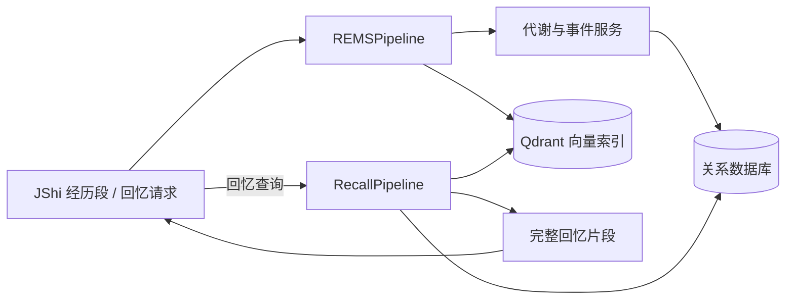

# 项目总览

## 项目职责

本仓库提供匠石的记忆后端实现，包名为 `rems`。匠石负责形成经历输入和发起查询；本项目负责把经历写入事件记忆、检索回忆材料、返回对象肖像，并保存必要的索引和观测记录。

## 主要组件

| 层 | 代码位置 | 职责 |
|---|---|---|
| 匠石端口模型 | `src/rems/port.py` | 定义经历批次、写入结果、回忆片段和后端协议 |
| 主编排 | `src/rems/pipeline.py` | 装配服务并实现写入、回忆、肖像和墓碑化入口 |
| 领域服务与技能 | `src/rems/services/`、`src/rems/skills/` | 代谢、事件封装、对象/情绪信息处理和肖像压缩 |
| 分阶段提炼 | `src/rems/services/refinement_service.py`、`src/rems/jobs/refine_memory.py` | 轻量事件到龄提炼、前轮 L1 再提炼、来源保留与旧节点隐藏 |
| 回忆检索 | `src/rems/recall/` | 语义/词面候选、对象事实、访问概率、排序和预算 |
| 持久化 | `src/rems/storage/` | SQLAlchemy 数据表、仓储和事件/对象数据 |
| HTTP API | `src/rems/api/` | FastAPI 应用和 `/api` 路由 |

## 核心数据流

写入时，一批有效经历被组合为一次代谢输入，但各段的对象和历史对话人归属通过 `SubSegment` 保留。封存事件进入关系存储并建立 L1 检索向量。回忆先限定主体、对象和时间，再形成候选并按字符预算选择完整表示。

## 当前实现边界

- `REMSPipeline` 当前实现 `ingest_batch`、`recall`、`portrait` 和 `tombstone` 等方法。
- `MemoryBackendPort` 协议还声明 `consolidate`、`dream`，但主编排目前没有这两个方法；声明不等于已接通后台任务。
- 事件模型支持基本/抽象事件字段，但不能据此推断所有抽象生成、巩固或做梦流程都已接入当前主流程。
- 当前回忆、事件字段和接口的细节见[回忆](recall.md)、[记忆](memory.md)和[匠石交互](jshi-integration.md)。

## 运行构成

- 配置入口：`REMSConfig`，环境变量前缀为 `REMS_`，支持 `.env` 和双下划线嵌套字段。
- 对话模型：OpenAI 兼容客户端，提供商地址和密钥通过配置提供。
- 嵌入：支持项目配置的嵌入器；单元测试可使用 `HashEmbedding`，不代表生产语义检索质量。
- 持久化：SQLAlchemy 数据库和 Qdrant 向量存储；开发/测试环境可配置成本地实例。

开发者如何安装、配置和运行离线验证见[开发与验证](development.md)。
